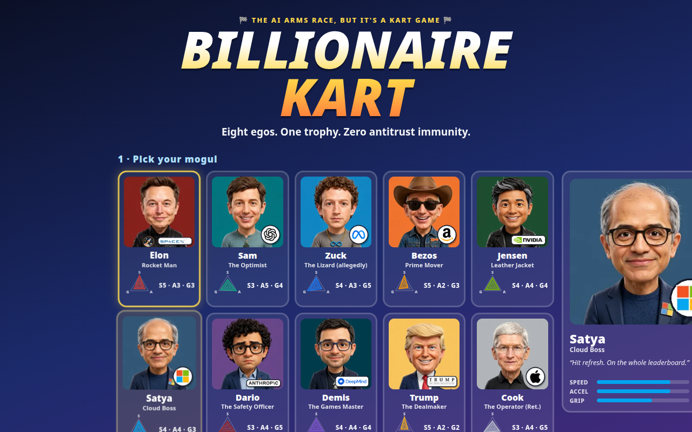
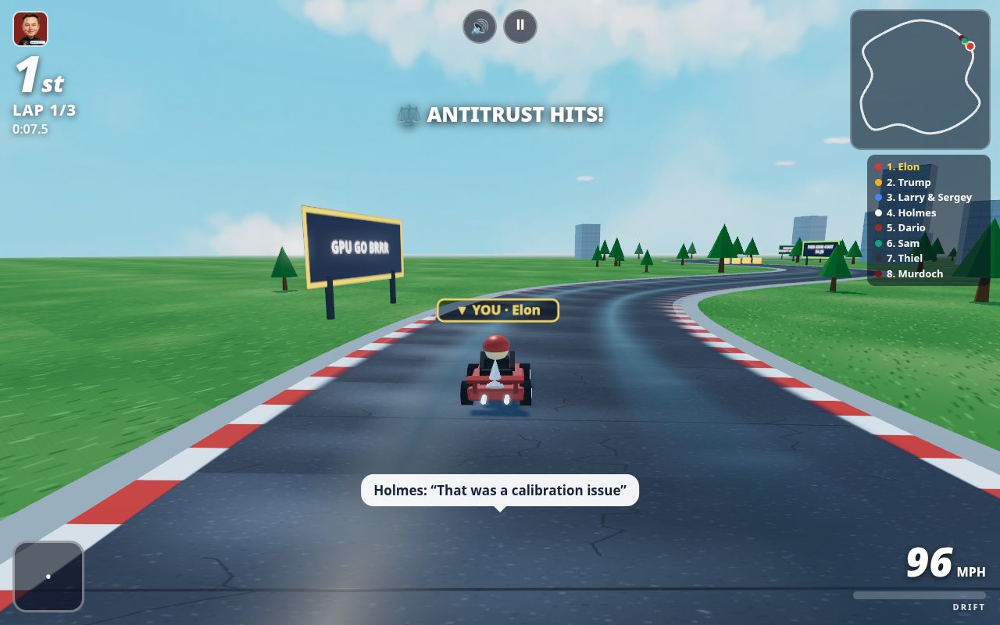

# 🏎️ Billionaire Kart: AI Arms Race

**Eight egos. One trophy. Zero antitrust immunity.**

A parody party kart racer that runs entirely in the browser — no install, no build
step, no assets to download. Seventeen tech-mogul caricatures (original low-poly
bobbleheads, not likenesses) race rocket karts around Silicon Valley and Mars,
armed with the actual weapons of their world: funding rounds, viral tweets,
subpoenas, antitrust suits, and market crashes.

Like the kart racers it lovingly riffs on, the fun comes from **position-weighted
items**: first place gets data leaks and paperwork, last place gets the comeback kit.
Skill still matters — the drift-boost is the difference between a podium and a
press release — but nobody runs away with the race.




## ▶️ Play it

Serve this folder with any static server and open it:

```bash
npx serve .          # or: python3 -m http.server 8000
# → http://localhost:8000
```

Or deploy to **GitHub Pages** (Settings → Pages → deploy from branch, root folder) —
it's a zero-build static site. After the first load it works **offline** (PWA
service worker caches the app shell and the Three.js CDN module).

## 🎮 Controls

| Input | Steer | Gas | Brake / Reverse | Item | Drift |
|---|---|---|---|---|---|
| **Keyboard** | A/D or ◀ ▶ | W or ▲ | S or ▼ | Space | Shift |
| **Gamepad** (any Bluetooth/USB) | Left stick / D-pad | RT or A | LT or B | X / □ | LB / RB |
| **Touch** | 4 switchable schemes — see *Control Lab* below | | | **tap the big item slot** (lower-left) | |
| **Gyro** (touch devices, tap 🧭 in-game) | Tilt the phone | per scheme | per scheme | tap item slot | per scheme |
| **Mouse** | Move mouse while holding click | Hold click | S | Space | Shift |

Also: **R** reset to track · **P / Esc** pause · **M** mute. Start on a gamepad pauses too.
**Rocket start:** during the countdown, start holding gas when the "2" shows (hold roughly
half a second to a second and a half) for a launch boost — hold it too long and you'll sputter.

### 🧪 Control Lab — four touch schemes (switch in the menu or mid-race from pause; your pick is remembered)

Design rule: **ITEM gets the easiest one-shot gesture in every scheme** (it's time-critical);
**DRIFT gets hold gestures** (you hold it through corners anyway). In every scheme, tapping the
big item slot also fires the item, with a haptic pulse.

1. **🕹️ Buttons** (default) — the classic ◀ ▶ / GAS / BRAKE / ITEM / DRIFT clusters + slot tap.
2. **👍 One-Thumb Stick** — touch anywhere on the right ~60% of the screen and a floating stick
   appears under your thumb: **press-and-hold = full gas** (no vertical throttle axis), drag
   left/right to steer (proportional, 10 px deadzone, full at ~60 px), **pull down + hold = brake**,
   **flick up + release = fire item**. Plain release = coast. **Item also: tap anywhere on the
   left ~40%** — no aiming, your left thumb just slaps the side of the screen. Drift: big
   hold-button mid-left.
3. **🕹️ Pedal & Stick** — left thumb is a floating steering stick (X only). Right thumb is a *pedal*
   with a four-word vocabulary: **hold** = full gas · **drag down** past ~24 px = brake (proportional) ·
   **quick tap** = **drift hop** (Mario Kart Tour style: drift starts when you push the steer stick,
   releases — boost and all — when you centre it) · **flick up** (~48 px, fast) = **ITEM**, gas resumes
   if you're still holding. Slot tap still works as a fallback. Hold-to-drift button bottom-right too.
4. **🚗 Auto-Gas** — the kart accelerates by itself; you just steer with a floating stick anywhere.
   **Item: any quick tap** — a second finger while steering, or a tap when you're not steering.
   BRAKE and DRIFT buttons included. "AUTO-GAS ON" shows in the HUD.

Plus two assists (cycle Auto / On / Off in the menu or pause; "Auto" = on for Auto-Gas only):
**🧭 Smart Steering** (Real Racing 3 style) — a gentle nudge toward the racing line, capped at 25%
authority and nearly off while drifting so it never fights your line; and **🌀 Auto-Drift** — hold
steer past 85% for a quarter second and the drift starts by itself. If tilt steering (🧭) is on,
it wins steering and stick X is ignored.

## 🎁 Items (the losers get the good stuff)

| Item | Effect |
|---|---|
| 💰 **Series A Boost** | 1.6 s speed burst (Jensen's lasts longer — the more you race, the more you save) |
| 💧 **Data Leak** | Dropped behind you as a glowing puddle; spins anyone who drives through it |
| 📜 **Subpoena** | Fast, straight-line projectile — skill shot |
| 🐦 **Viral Tweet** | Homes in on the racer directly ahead of you |
| ⚖️ **Antitrust Suit** | Flies up the track and explodes on the race leader (AoE spin) |
| ⭐ **Viral Moment** | 6 s invincible + faster; spin rivals by touching them |
| 📉 **Market Crash** | Shrinks and slows *everyone ahead of you* |
| 📣 **Spin Team** | The leader's counter-play: a shockwave that destroys nearby projectiles/hazards, spins adjacent karts — and, timed within its 0.6 s window, swats an incoming Antitrust Suit out of the air |
| 💣 **Pink Slip** | A bomb dropped behind you: flashing, beeping, explodes after 1.6 s (or on contact) with an AoE spin |
| 📰 **Smear Campaign** | Inks *everyone ahead of you* — AI weave blind and slow; a human leader gets their screen splatted |
| 👻 **Insider Trading** | Steals a random rival's held item (a boost if nobody's holding) and turns you intangible for 3 s — hazards and shells pass through you |
| 🏆 **Series F** | A 5 s funding window: every ITEM press inside it fires another mini-boost |
| 🛟 **Government Bailout** | Last place only: the state auto-drives your kart at 130% speed for up to 5.5 s, bulldozing rivals — but the money runs out the moment you reach 3rd. Too big to fail, too slow to win |

Pick up the floating **? boxes** to draw an item. What you draw depends on where
you're running — the further back you are, the nastier it gets.

## 🏆 The racers

Elon (top speed) · Sam (acceleration) · Zuck (grip — allegedly human) · Bezos (heavy,
fast, slow off the line) · Jensen (handling + long boosts) · Satya (balanced) ·
Dario (charges drift boosts fastest) · Demis (all-rounder) · Trump (fast, slippery) ·
Cook (grip) · Bill (slow kart, very smart AI) · Larry & Sergey (a duo — two drivers,
one kart) · Thiel (high-skill AI) · Holmes (fastest stats, but her prototype engine
randomly sputters) · Ellison (media mogul) · Murdoch (worst launch in the game, but
the most consistent AI — he never makes a mistake) · Soros (the final boss:
joint-highest AI skill).

**Field of 8:** you pick one, the other 7 seats are sampled at random from the
pool every race — so every grid is a different grudge match.

Each has stat trade-offs and shouts parody barks when boosted, hit, or victorious.

## 🗺️ Tracks & modes

- **Silicon Valley GP** — daytime, palm trees, office towers, synergy billboards
- **Mars GP** — sunset, red dust, mesas, and a rocket on Elon's home turf

3 laps, 8 racers on track (you + 7 AI sampled at random from the 17-racer pool each race), live standings + minimap, three AI difficulties
(😌 Chill / 🌶️ Spicy / 🤬 Unhinged) with rubber-band AI so the pack stays together.
Best lap and best race per track are saved locally.

## 🛠️ Tech notes

- **Three.js** (CDN import map) — zero build, zero bundler, zero downloaded assets.
  Every model is procedural low-poly geometry; every sound (engine, music, items,
  fanfare) is synthesized live with WebAudio.
- Track = closed Catmull-Rom spline sampled at 900 points. Arcade physics uses a
  velocity-heading vs kart-heading grip model (that's what makes drifting slide),
  spline-sampled progress for laps/ranking, and lateral offset for off-road/walls.
- `tools/bot-test.mjs` is a headless-Chromium playtest bot (inspired by the
  Battle Drones / Aiden's Revenge write-ups): it loads the page, fails on any
  console error, starts a race via the `window.BK` debug API, auto-drives for
  20+ seconds, asserts the player kart actually progresses with no NaN state,
  and saves the screenshots above.

```bash
cd tools && npm install   # installs puppeteer (downloads Chromium once)
node bot-test.mjs
```

## 🗺️ Roadmap

- **Phone-as-controller pairing** (WebRTC data channel: phone shows a pairing code,
  its gyro/touch becomes a second controller for the desktop race)
- Online multiplayer (WebSocket relay), more tracks, grand-prix cup mode
- Split-screen local multiplayer

## ⚖️ Fine print

A parody. The racers are fictional caricatures; any resemblance to actual
billionaires is entirely the point. MIT licensed — see [DESIGN.md](DESIGN.md)
for the full design rationale.
