# Billionaire Kart

**Eight egos. One trophy.** A parody party kart racer that runs in your browser.

### [Play it now](https://okgodoit.github.io/Billionaire-Kart/)

No install. Works on a computer with a keyboard or controllers, and on a phone with touch. Add it to your home screen for full screen; tracks you have already played keep working offline.

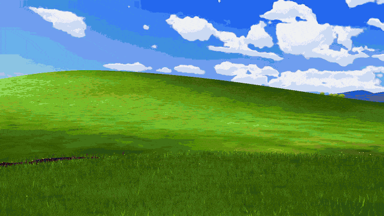

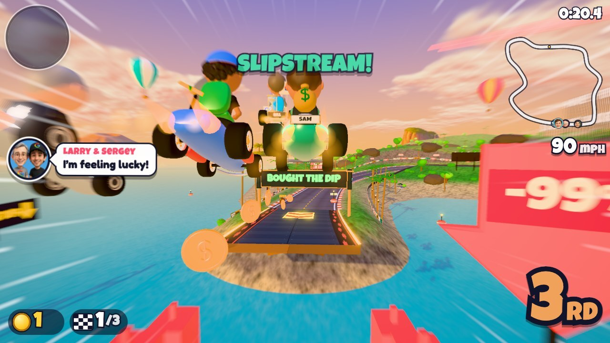

Sixteen caricatured tech moguls race rocket karts through their own world, armed with what they actually fight with: funding rounds, viral tweets, subpoenas, antitrust suits, and market crashes. The further back you are, the better your items, so nobody is ever out of the race. Skill still wins: drift well and you leave everyone behind.

It is a parody. It is not affiliated with, or endorsed by, anyone in it.

## What is in it

- **Twelve tracks in three cups**, each with its own signature moment, soundtrack, and hazards.
- **Grand Prix, Quick Race, and Time Trial** (with a ghost of your best run), three engine classes, and three levels of rivals.
- **One to four players** on one screen.
- **Sixteen racers** with their own stats, signature karts, and things to say when they hit you, and a special of their own that changes how they drive.
- **Sixteen items**, weighted by position. Leaders get defense; the back of the pack gets the comeback kit.
- **Real kart-racer driving**: hop into a drift and hold it for a blue, orange, or purple mini-turbo; trick off ramps; slipstream; collect coins for top speed; nail the rocket start.
- **A generated soundtrack** with a theme for every track, an announcer, and a final-lap lift.

| | |
|---|---|
| 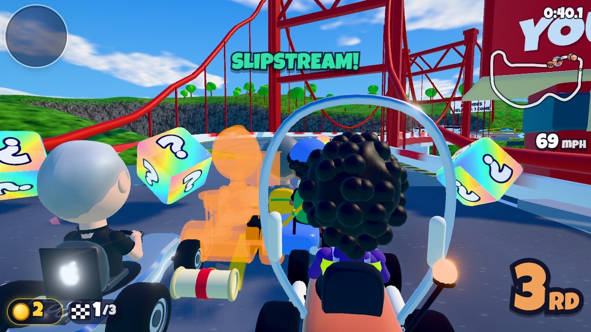 | 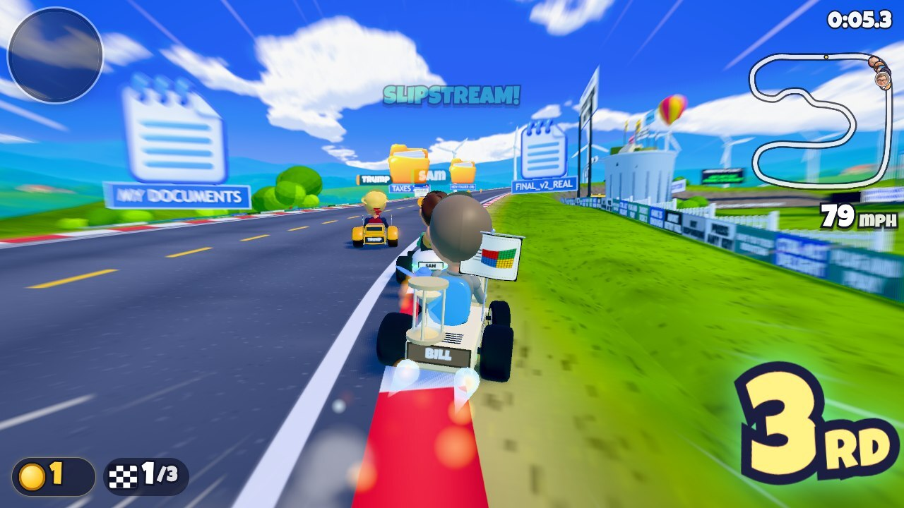 |
| 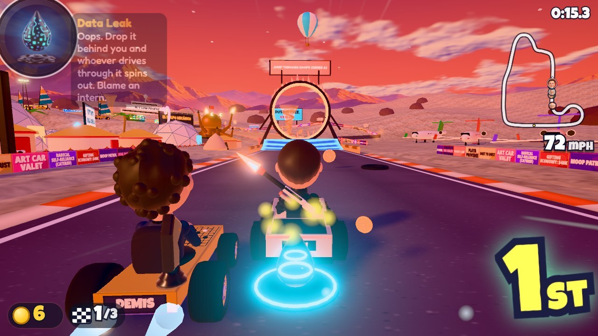 | 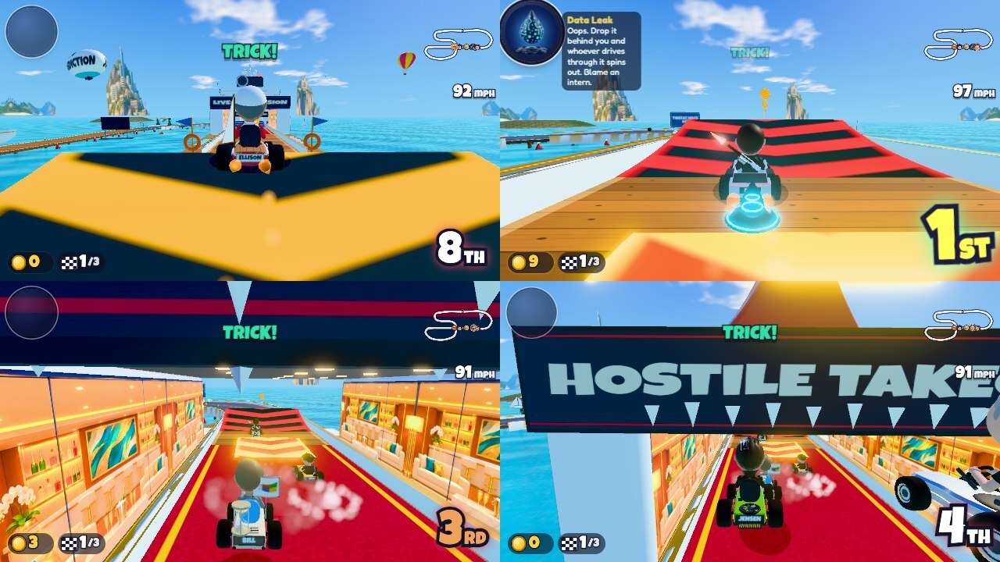 |
| 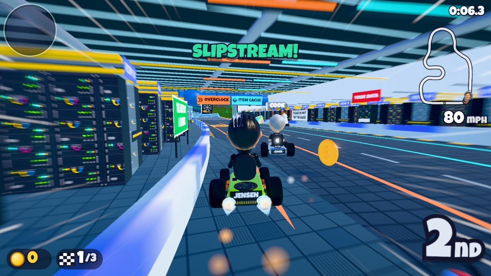 | 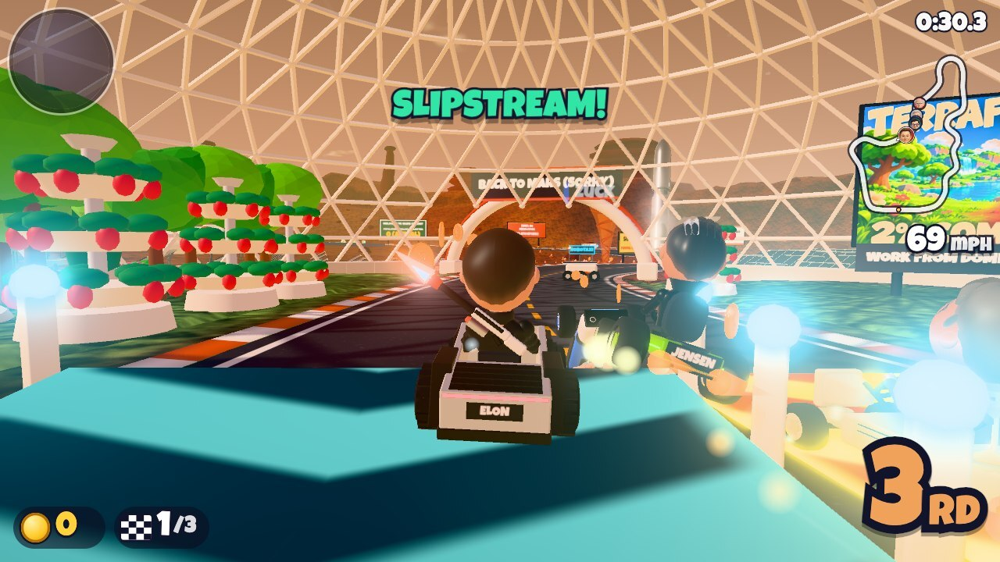 |
| 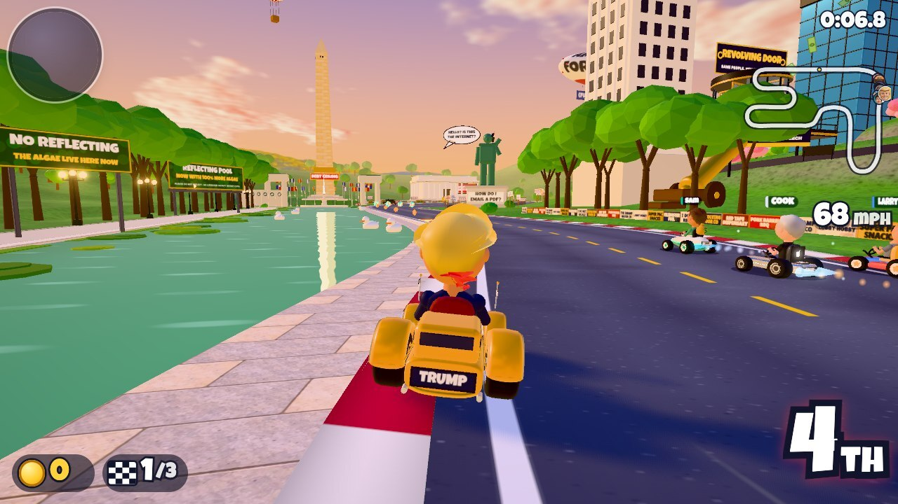 | 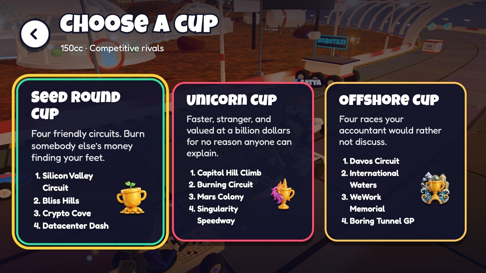 |
| 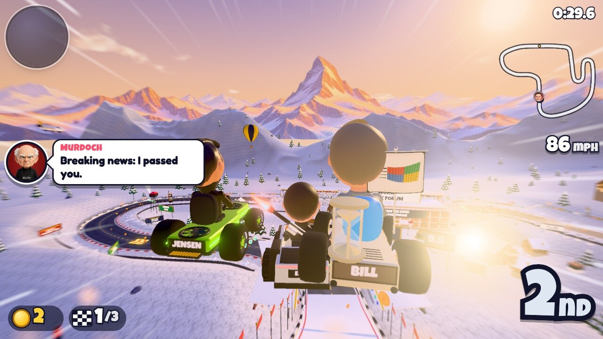 | 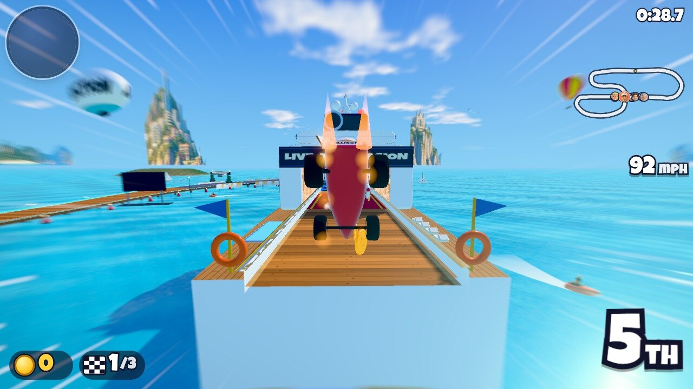 |
| 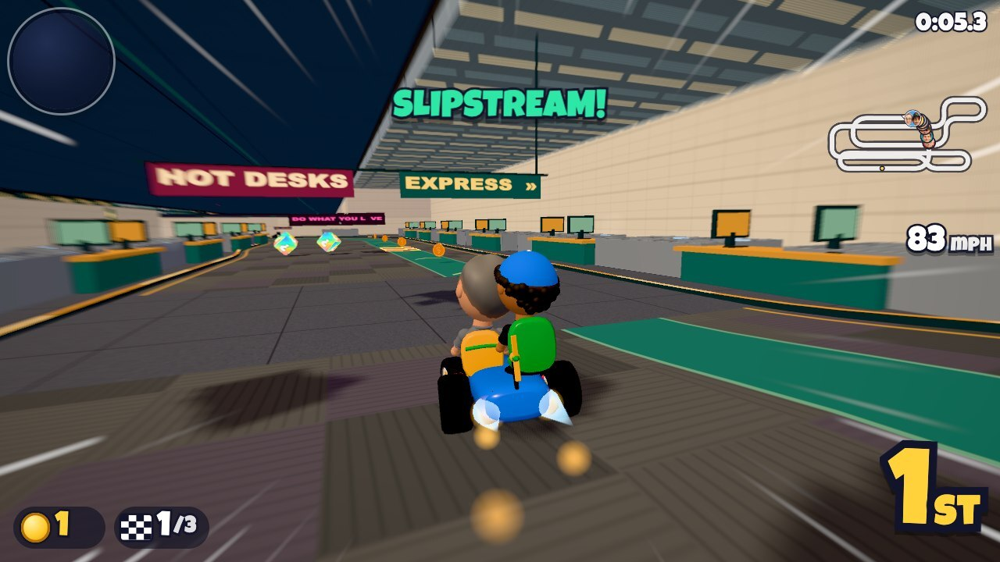 | 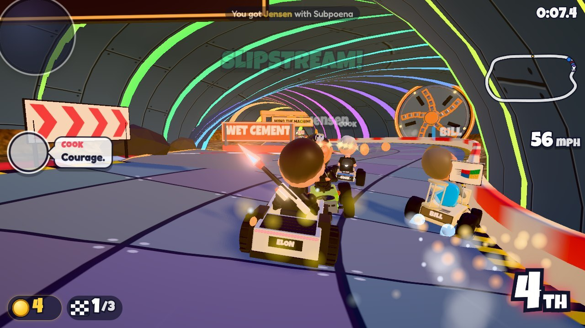 |
| 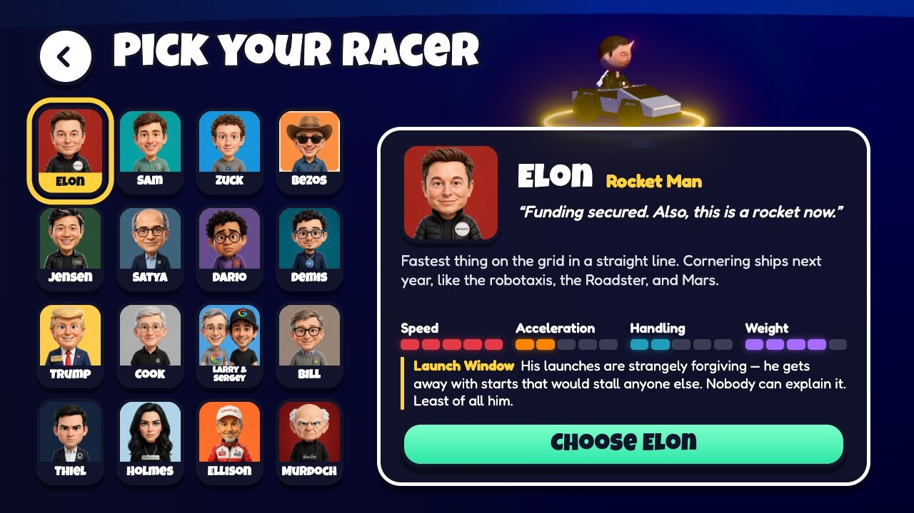 | 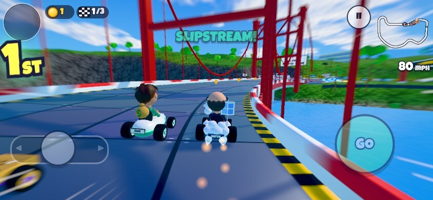 |

### The grid

Every racer drives a kart of their own: a steel wedge, a rocket with a parcel strapped on, a graphics card with working fans, a stretch limo, a yacht, a beige desktop PC, a VR headset, a cloud, a Go board, and more.

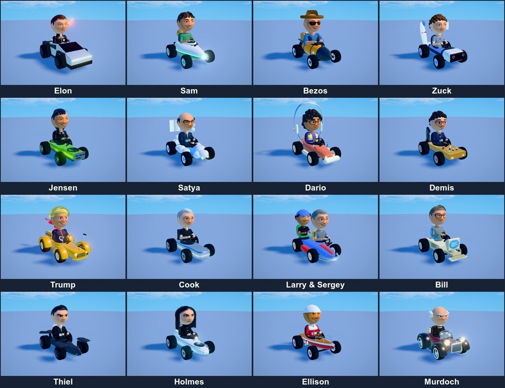

## Controls

| | Keyboard | Controller | Touch |
|---|---|---|---|
| Steer | A D or ← → | Left stick | Slide your left thumb |
| Accelerate | W or ↑ | A or right trigger | Hold the right side |
| Drift and hop | Space | Right bumper or X | Steer hard over; straighten up to boost |
| Use item | E or Enter | Left bumper or Y | Tap the left side, or flick your right thumb up |
| Brake and reverse | S or ↓ | B or left trigger | Pull your right thumb down |
| Look behind | Q | Click the right stick | |
| Pause | Esc | Start | Pause button |

Two players can share a keyboard: one on W A S D with Space, the other on the arrow keys with Enter. On a phone there are no buttons to find: the left half of the screen steers and the right half is the pedal. Menus work with the phone upright or on its side; races are played on its side. Automatic accelerate and tilt steering are in Options on phones.

**Going faster**

- Hold drift while turning. Steering into the drift charges it faster. Let go for the boost.
- Hold accelerate just after the **2** appears in the countdown for a rocket start.
- Press drift as you leave a ramp for a trick boost when you land.
- Each coin makes you a little faster, up to ten. Getting hit costs three.
- Sit right behind another kart for a moment to slingshot past.

## Tracks

| Seed Round Cup | Unicorn Cup | Offshore Cup |
|---|---|---|
| **Silicon Valley Circuit** runs from Sand Hill Road through campus to the Golden Gate Bridge. | **Capitol Hill Climb** follows the Reflecting Pool before the turn back toward the Capitol. | **Davos Circuit** climbs through a summit slalom to a ski jump above the town. |
| **Bliss Hills** climbs between desktop icons. Take the update-window jump or the Minesweeper meadow. | **Burning Circuit** threads the playa camps and jumps through a ring of fire. | **International Waters** sends you across three moving yachts, deck to deck. |
| **Crypto Cove** climbs a green price chart and jumps the crash to an island landing. | **Mars Colony** sends karts over a low-gravity canyon toward the colony’s biodome. | **WeWork Memorial** races through office floors, up a stairwell, and along a hot-desk express lane. |
| **Datacenter Dash** runs between server racks and out around the coolant lake. | **Singularity Speedway** banks a rainbow road around a watchful machine. | **Boring Tunnel GP** runs past a working cutter and opens an express bore on the last lap. |

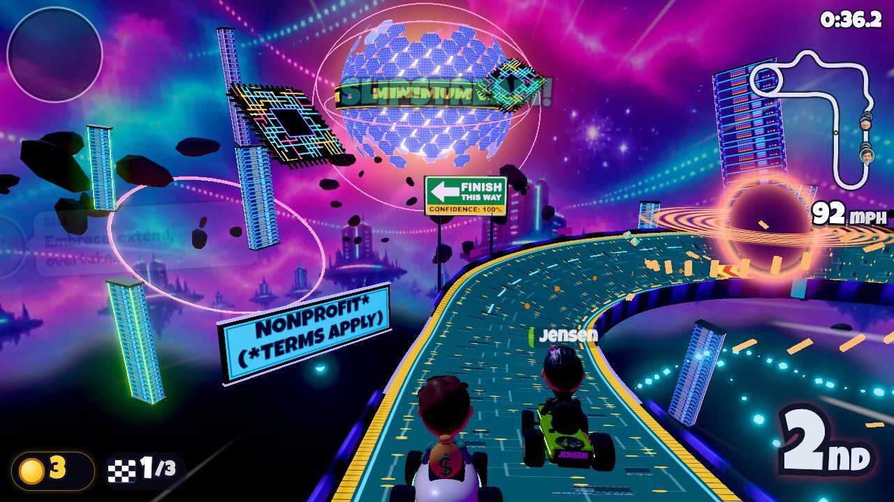

## Running it yourself

It is a static site: plain ES modules, no build step, three.js vendored in `vendor/`.

```bash
python3 -m http.server 8765
```

Then open http://localhost:8765. Development tools need Node and `npm install` once:

```bash
node tools/sim.mjs            # headless AI races on every track: timing, incidents, item balance
node tools/bot.mjs            # drives the real game in headless Chrome, menus to results; add --mobile for phone size
node tools/track-shots.mjs silicon-valley out.jpg   # contact sheet of a whole track
```

## How it is built

| Folder | What lives there |
|---|---|
| `src/track` | Tracks as data: a banked 3D spline with ramps, boost pads, tunnels, bridges, and obstacles. Road, kerbs, walls, and terrain are all generated from it. |
| `src/race` | The simulation: kart physics, AI drivers, items, race rules. It has no rendering, so whole races run headless for testing. |
| `src/render` | Renderer and post-processing, sky, particles, kart animation, chase camera, scenery helpers. |
| `src/models` | Procedural karts, bobblehead drivers, items, and the scenery prop library. |
| `src/tracks` | One file per track. See [docs/track-authoring.md](docs/track-authoring.md). |
| `src/ui`, `src/game`, `src/audio` | HUD, menus, touch controls, the app shell, and the audio engine. |

Faces, backdrops, the icon, sound effects, announcer lines, and music were generated with OpenAI's image model and ElevenLabs; the scripts and every prompt are in `tools/gen-*.mjs`. Design research is in `docs/research/`.

The original single-file version of the game is preserved at the `v1-legacy` tag.
