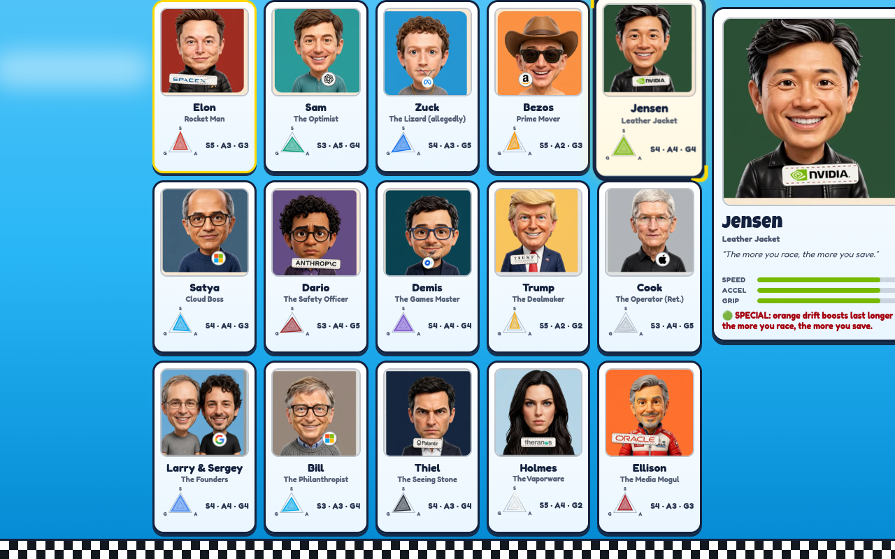
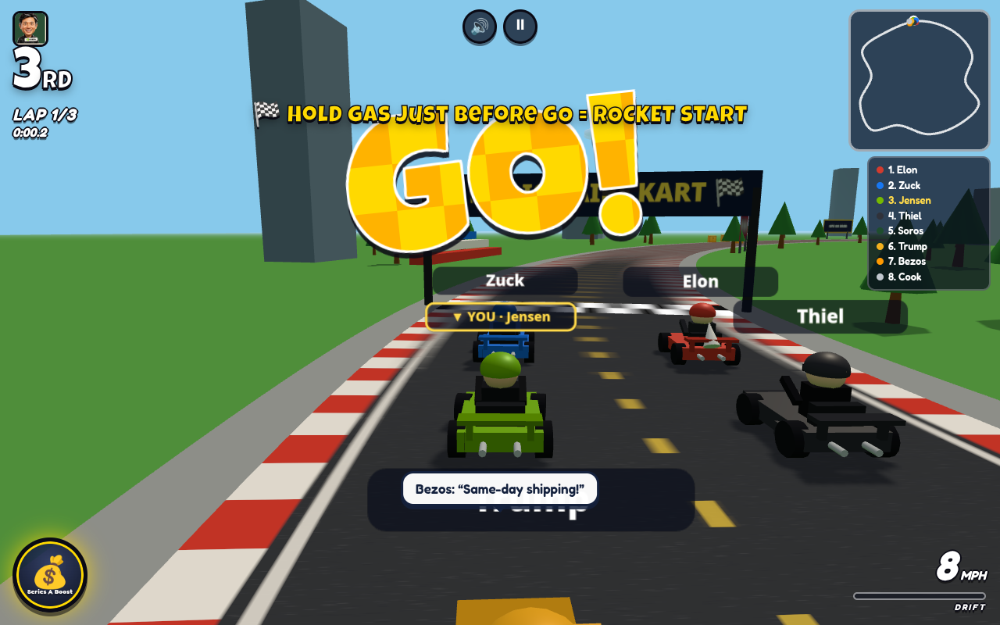
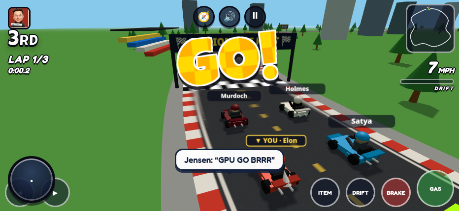
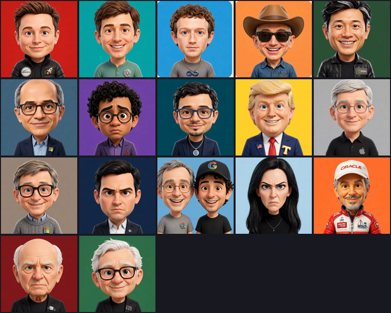

# 🏎️ Billionaire Kart: AI Arms Race

**Eight egos. One trophy. Zero antitrust immunity.**

### ▶️ [Play it now — no install, runs in your browser](https://okgodoit.github.io/Billionaire-Kart/)

A parody party kart racer that runs entirely in the browser. Seventeen tech-mogul
caricatures race rocket karts around Silicon Valley and Mars, armed with the actual
weapons of their world: funding rounds, viral tweets, subpoenas, antitrust suits,
and market crashes.

Like the kart racers it lovingly riffs on, the fun comes from **position-weighted
items**: first place gets data leaks and paperwork, last place gets the comeback
kit. Skill still matters — the drift-boost is the difference between a podium and
a press release — but nobody runs away with the race.


## 📸 Screenshots

**Character select** — 17 racers in the pool; you pick one, the other 7 seats on the
grid are sampled at random every race, so every start is a different grudge match.



**Race start, Silicon Valley GP** — rocket starts, live standings, minimap, and a
grid full of rivals who all think they bought the trophy already.



**On mobile** — full touch controls, a tappable item slot, and four switchable
control schemes (see *Control Lab* below). Add it to your home screen and it plays
offline like a real app.



**The full roster** — every portrait is generated art with the racer's real company
logo worn in-character: a stitched SpaceX mission patch, an embroidered Apple on a
polo, an ORACLE sailing cap, a gold "T" lapel pin…



## 🎮 How to play

Pick your mogul → 3 laps against 7 AI rivals → grab the floating **? boxes** to draw
items → drift everything. ~3–4 minutes a race. Three AI difficulties
(😌 Chill / 🌶️ Spicy / 🤬 Unhinged) with rubber-banding so the pack stays together.
Best lap and best race per track are saved locally.

| Input | Steer | Gas | Brake / Reverse | Item | Drift |
|---|---|---|---|---|---|
| **Keyboard** | A/D or ◀ ▶ | W or ▲ | S or ▼ | Space | Shift |
| **Gamepad** (any Bluetooth/USB) | Left stick / D-pad | RT or A | LT or B | X / □ | LB / RB |
| **Touch** | 4 switchable schemes — see *Control Lab* below | | | **tap the big item slot** (lower-left) | |
| **Gyro** (touch devices, tap 🧭 in-game) | Tilt the phone | per scheme | per scheme | tap item slot | per scheme |
| **Mouse** | Move mouse while holding click | Hold click | S | Space | Shift |

Also: **R** reset to track · **P / Esc** pause · **M** mute. Start on a gamepad pauses too.

**Rocket start:** during the countdown, start holding gas when the "2" shows (hold
roughly half a second to a second and a half) for a launch boost — hold it too long
and you'll sputter.

### 🧪 Control Lab — four touch schemes

Switch in the menu or mid-race from pause; your pick is remembered. Design rule:
**ITEM gets the easiest one-shot gesture in every scheme** (it's time-critical);
**DRIFT gets hold gestures** (you hold it through corners anyway). In every scheme,
tapping the big item slot also fires the item, with a haptic pulse.

1. **🕹️ Buttons** (default) — the classic ◀ ▶ / GAS / BRAKE / ITEM / DRIFT clusters + slot tap.
2. **👍 One-Thumb Stick** — touch-and-hold anywhere on the right ~60% of the screen:
   **holding is gas** (no fiddly throttle axis), drag left/right to steer
   (proportional — ~10 px deadzone, full lock at ~60 px), pull down to brake, and a
   **quick flick up fires your item**. Release to coast. Drift: big hold-button
   mid-left; item slot tap works too.
3. **🕹️ Pedal & Stick** — left thumb is a floating steering stick (X only). Right
   thumb is a *pedal* with a four-word vocabulary: **hold** = full gas ·
   **drag down** past ~24 px = brake (proportional) · **quick tap** = **drift hop**
   (Mario Kart Tour style: the drift starts when you push the steer stick, and
   releases — boost and all — when you centre it) · **flick up** (~48 px, fast) =
   **ITEM**, gas resumes if you're still holding. Slot tap still works as a
   fallback, and there's a hold-to-drift button bottom-right.
4. **🚗 Auto-Gas** — the kart accelerates by itself; you just steer with a floating
   stick anywhere. **Item: any quick tap** — a second finger while steering, or a
   tap when you're not steering. BRAKE and DRIFT buttons included, and "AUTO-GAS
   ON" shows in the HUD.

Plus two assists (cycle Auto / On / Off in the menu or pause; "Auto" = on for
Auto-Gas only): **🧭 Smart Steering** — a gentle nudge toward the racing line,
capped at 25% authority and nearly off while drifting so it never fights your
line; and **🌀 Auto-Drift** — hold steer past 85% for a quarter second and the
drift starts by itself. If tilt steering (🧭) is on, it wins steering and stick
X is ignored.

## 🎁 Items — the losers get the good stuff

What you draw from a ? box depends on where you're running: 1st place mostly draws
defence, last place draws the comeback kit. No coin-style duds, no self-harm items.

| Item | Effect |
|---|---|
| 💰 **Series A Boost** | 1.6 s speed burst (Jensen's lasts longer — the more you race, the more you save) |
| 💧 **Data Leak** | Dropped behind you as a glowing puddle; spins anyone who drives through it. "💧 DATA BREACH!" |
| 📜 **Subpoena** | Fast, straight-line projectile — a skill shot |
| 🐦 **Viral Tweet** | Homes in on the racer directly ahead of you |
| ⚖️ **Antitrust Suit** | Flies up the track and explodes on the race leader (AoE spin) |
| ⭐ **Viral Moment** | 6 s invincible + faster; spin rivals by touching them |
| 📉 **Market Crash** | Shrinks and slows *everyone ahead of you* |
| 📣 **Spin Team** | The leader's counter-play: a shockwave that destroys nearby projectiles/hazards and spins adjacent karts — and, timed within its 0.6 s window, swats an incoming Antitrust Suit out of the air |
| 💣 **Pink Slip** | A bomb dropped behind you: flashing, beeping, explodes after 1.6 s (or on contact) with an AoE spin |
| 📰 **Smear Campaign** | Inks *everyone ahead of you* — AI weave blind and slow; a human leader gets their screen splatted |
| 👻 **Insider Trading** | Steals a random rival's held item (a boost if nobody's holding) and turns you intangible for 3 s — hazards and shells pass through you |
| 🏆 **Series F** | A 5 s funding window: every ITEM press inside it fires another mini-boost |
| 🛟 **Government Bailout** | 7th/8th place only: the state auto-drives your kart at 130% speed for up to 5.5 s, bulldozing rivals — but the money runs out the moment you reach 3rd. Too big to fail, too slow to win |

## 🏆 The racers

Stats are **SPEED / ACCELERATION / GRIP** (1–5). Every racer has trade-offs, a
special quirk, and parody barks for when they're boosted, hit, or victorious.

| Racer | Title | S · A · G | The deal |
|---|---|---|---|
| 🚀 **Elon** | Rocket Man | 5 · 3 · 3 | Top speed on the grid |
| 🤖 **Sam** | The Optimist | 3 · 5 · 4 | Acceleration — gone before the ink dries |
| 🦎 **Zuck** | The Lizard (allegedly) | 4 · 3 · 5 | Grip. Allegedly human |
| 📦 **Bezos** | Prime Mover | 5 · 2 · 3 | Heavy, fast, slow off the line |
| 🏎️ **Jensen** | Leather Jacket | 4 · 4 · 4 | Handling, and boosts that last longer |
| ☁️ **Satya** | Cloud Boss | 4 · 4 · 3 | Balanced, enterprise-grade |
| 🦺 **Dario** | The Safety Officer | 3 · 4 · 5 | Charges drift boosts fastest |
| ♟️ **Demis** | The Games Master | 4 · 4 · 4 | All-rounder with a grandmaster AI |
| 🦅 **Trump** | The Dealmaker | 5 · 2 · 2 | Fastest tier, grip of a wet soap bar |
| 🍏 **Cook** | The Operator (Ret.) | 3 · 4 · 5 | Grip king, metronome-consistent |
| 🔎 **Larry & Sergey** | The Founders | 4 · 4 · 4 | A duo — two drivers, one kart |
| 🪟 **Bill** | The Philanthropist | 3 · 3 · 4 | Slow kart, smartest AI on the grid |
| 👁️ **Thiel** | The Seeing Stone | 4 · 3 · 4 | High-skill AI — sees your line before you drive it |
| 🧪 **Holmes** | The Vaporware | 5 · 4 · 2 | Fastest stats, but her prototype engine randomly sputters |
| 🏝️ **Ellison** | The Media Mogul | 4 · 3 · 3 | Owns the island and the coverage |
| 🗞️ **Murdoch** | The Succession | 3 · 1 · 5 | Worst launch in the game, most consistent AI — never makes a mistake |
| 💸 **Soros** | The Final Boss | 4 · 4 · 4 | Joint-highest AI skill. He funds the final boss |

## 🗺️ Tracks

Every track gets equal effort: playable geometry first, then a full dressing pack —
a signature set piece, themed signage, and at least one animated element.

**Live now:**

- ✅ **Silicon Valley GP** — daytime, palm trees, office towers, synergy billboards,
  and a startup graveyard out back
- ✅ **Mars GP** — sunset, red dust, mesas, and a rocket on Elon's home turf
  ("EARTH: DO NOT RETURN")

**In production:**

- 🚧 **AI Datacenter GP** — a lap that drives *through* the server hall, past a lake
  that drains as you race and a live "WATER GULPED" counter
- 🚧 **International Waters GP** — duelling superyachts, 12 nautical miles out,
  where taxes are a social construct
- 🚧 **White House GP** — Reflecting Pool straights and a $300M ballroom construction
  zone (privately funded, allegedly)
- 🚧 **Bliss GP** — rolling green hills straight out of the Windows XP wallpaper,
  Clippy included. The calm one
- 🚧 **Boring Tunnel** — yes, there is a flamethrower joke. No, it's not a flamethrower
- 🚧 **Davos Circuit** — private jets, snow banks, GREAT RESET AHEAD
- 🚧 **Metaverse Plaza** — 38 users online. Legless statues
- 🚧 **WeWork Memorial GP** — kombucha taps and community-adjusted EBITDA
- 🚧 **Burning Man GP** — dust devils, valet parking $40K, radical self-reliance
- 🚧 **Bahamas Crypto GP** — beachfront ruins, "RESERVES: TRUST US", 0% tax, 100% vibes

## 🛠️ Tech notes

- **Three.js** (CDN import map) — **zero build step**, zero bundler, zero downloaded
  assets. Every kart and track prop is procedural low-poly geometry; every sound
  (engine, music, items, fanfare) is synthesized live with WebAudio.
- **PWA**: installable to the home screen, and after the first load it works
  **offline** — the service worker caches the app shell and the Three.js module.
- A track is a closed Catmull-Rom spline sampled at 900 points. Arcade physics uses
  a velocity-heading vs kart-heading grip model (that's what makes drifting slide),
  spline-sampled progress for laps/ranking, and lateral offset for off-road/walls.
  60 fps on phones, no physics engine.
- `tools/bot-test.mjs` is a headless-Chromium playtest bot: it loads the page, fails
  on any console error, starts a race via the `window.BK` debug API, auto-drives,
  and asserts the player kart actually progresses with no NaN state.

Run it locally with any static server:

```bash
npx serve .          # or: python3 -m http.server 8000
# → http://localhost:8000
```

Run the bot test:

```bash
cd tools && npm install   # installs puppeteer (downloads Chromium once)
node bot-test.mjs
```

## 🗺️ Roadmap

- **📱 Phone-as-controller pairing** — the big one: a WebRTC data channel pairs your
  phone to a desktop race with a code; the phone's gyro and touch become your
  controller while the race plays on the big screen. (Today you can already steer
  by gyro/touch on the phone itself.)
- Online multiplayer (WebSocket relay)
- Grand-prix cup mode across the full track slate
- Split-screen local multiplayer

## ⚖️ Fine print

A parody. The racers are fictional caricatures; any resemblance to actual
billionaires is entirely the point. See [DESIGN.md](DESIGN.md) for the full design
rationale and [CONTRIBUTING.md](CONTRIBUTING.md) for how this repo is built.
