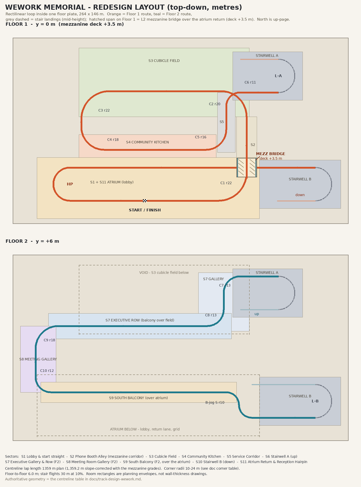

# WeWork Memorial — REDESIGN (for Roger's approval before any build)

**Status: DESIGN ONLY. Part of #86 (Cup 3).** This document replaces the design
that produced PR #119, which Roger rejected and closed on Nov 12, 2026. Nobody
builds from this doc until Roger approves it. When he does, this doc is the
contract: the verification checklist at the end is written so the build either
passes it objectively or it does not ship.

Cup position: fourth track of Cup 3 (International Waters, Boring Tunnel,
Davos, WeWork Memorial). The lead wires the cup; this doc covers the track.

**Amendment — Nov 12, 2026 (Roger-approved).** Reviewing the first version of
this doc, Roger spotted that the Floor 1 centreline crossed *itself*: the
east corridor (L2, northbound, early lap) met the atrium return (L17,
westbound, late lap) at grade at (68, 32), both at y = 0, with no junction
specified — and this doc's own walls-on-both-sides rule would have walled
the crossing shut. The crossing is structural (Stairwell A is reached up the
east side, Stairwell B exits at the east), so it is now **grade-separated as
building architecture, not as a road bridge**: the lobby's wide **feature
ramp** climbs to a **mezzanine** walkway at y = +3.5, the corridor crosses
the return lane on a **glass-sided mezzanine bridge**, and a second feature
ramp comes down into the cubicle field. The plan-view centreline, every
corner radius and every room are unchanged; only the height profile of
L1-east / C1 / L2 / C2 / L3-east is new (§ Centreline, height profile). A
flyover would repeat PR #119's failure in miniature — if the level change
does not read as a mezzanine and a feature stair, the build has failed.

---

## Concept

A grand prix run through **one floor plate of an abandoned WeWork**, two
storeys of it, with the roof on. You start on a grid in the lobby atrium,
under a mezzanine balcony, facing a valuation board that reads
**$47,000,000,000** struck through to **$0 (COMMUNITY-ADJUSTED)**. From there
the lap is a facilities tour of a dead coworking empire: up the lobby's wide
bleacher-style feature ramp to the mezzanine — a glass-railed walkway over
the atrium that bridges clean over the return lane you will come home on at
the lap's end — a slalom past phone-booth pods along the mezzanine lounge,
down the far feature ramp into a sea of empty cubicles under a half-dark
ceiling, the community kitchen with its eternal kombucha keg, a
service corridor with an out-of-cash SoftBank ATM — then up a switchback
stairwell, along the executive floor where the parachutes are golden and the
offices are glass, past meeting rooms named SYNERGY and DISRUPTION, out onto
a balcony that hangs over the lobby you started in, and down a red-lit fire
stair to a reception desk that is still asking you to check in with the
community manager. Every metre of it is indoors. There is no sky in this
track — not overhead, not through a window, not in the menu thumbnail.

**The shape is the joke's delivery mechanism.** A real office floor is a
rectangle full of right angles, so the course is rectilinear: corridor
straights joined by genuine right-angle drift corners, rooms as wider
chambers, and the two floor changes done the way buildings do them —
switchback stairwells with 180° landings. If a frame of this track could be
mistaken for an outdoor circuit, the build has failed.

*Top-down layout, two floors. Orange = Floor 1 route, teal = Floor 2 route,
dashed = stair landings at mid-height. The authoritative geometry is the
centreline table below; the diagram is the same numbers rendered.*

---

## What went wrong last time

The old design doc's *concept* was right — a Coconut Mall-style two-level
interior — and the old build review even approved the geometry. What shipped
in PR #119 was only the road: a smooth, flowing, banked circuit
(`sky: 'golden'`, outdoor terrain palette, no `tunnels[]`, exactly one token
`sides` wall entry) with WeWork sign dressing scattered beside it. The
building was never built. There was no ceiling anywhere, the "mezzanine" was
an open-air elevated roadway over blank terrain, and the layout curved like a
garden path instead of turning like an office. Roger's verdict: *"It's
supposed to take place inside of an office building… Why is there a sky?"*

Three root causes, and how this redesign answers each:

1. **Enclosure was decoration, not structure.** The old doc described rooms
   but never specified the mechanism that encloses them, so the builder
   shipped the road and skipped the architecture. → This doc has an
   **enclosure spec** (§ Enclosure) naming the exact toolkit mechanisms per
   sector, and a checklist that greps the shipped file for them.
2. **The layout was a spline first, an office second.** Smooth curves were
   baked into the control points before anyone asked what an office floor
   looks like. → This doc fixes the geometry as a **centreline table of
   straights and right-angle arcs** (§ Centreline) that the builder converts
   to path points, with radii verified against `tools/track-map.mjs`.
3. **Nobody checked a frame for sky.** → The verification checklist
   (§ Verification) makes "zero sky pixels, a ceiling or interior soffit in
   the upper third of every contact-sheet frame" a pass/fail gate.

---

## Reference frames (viewed, per the standing rule)

- **`mk8-coconutmall.jpg` (Mario Kart 8, Coconut Mall)** — the primary
  reference. What it teaches, converted: storefronts as *continuous wall
  dressing on both sides* (our glass office fronts and cubicle walls never
  break for "scenery gaps"); a *railed upper balcony running around the
  atrium* (our S9 South Balcony + S7 executive row); *vertical hanging
  banners* (our HUSTLE / COMMUNITY banners in the atrium); the *escalator
  visible across the atrium* advertising the level change before you reach it
  (our Stairwell B is a glass tower inside the atrium's east end, visible
  from the start straight — you see where the lap will take you); warm
  interior light everywhere, tiled floor. Its mezzanine staging is also the
  model for our S2 level change: the way up is a broad architectural feature
  inside the atrium — Coconut Mall's escalator move — and the span over the
  lower route is a glass-railed mezzanine bridge, never a road flyover.
  Coconut Mall has a skylight; **we do not copy it** — Roger bans sky
  entirely, so our atrium roof is a solid slab with light panels.
- **`mkw-peach.jpg`** — the benchmark for *signage scale*: neon you can read
  at racing speed because it is building-sized. Converted: the valuation
  board and the ELEVATE mural are wall-filling letters, not posters.
- **`~/workspace/research_notes/mk-reference/ANALYSIS.md`** patterns applied:
  continuous edge dressing (no bare wall longer than ~15 m without a door,
  sign, booth or board), one hero set piece per frame, the road surface tells
  the story (carpet in the office zones, stone in the lobby, metal on the
  stairs), and stuff in the air (banners, hanging signs, a fallen one).

---

## The plate and the loop

One rectangular floor plate, **264 × 146 m** (x ∈ [−116, 148], z ∈ [−70, 76];
z increases south). Two floors: **Floor 1 at y = 0, Floor 2 at y = +6.0 m** —
plus the lobby **mezzanine at y = +3.5 m** between them. The lap is a single
rectilinear loop of **1,359.2 m** of road centreline (slope-corrected for
the mezzanine grades; plan lengths sum to 1,359.0 m) — the longest lap in
the cup, justified because it is a full floor plate toured room by room;
expected sim lap ≈ 41 s at the fleet's standard pace, inside the authoring
band.

Vertical rhythm: the lap starts at F1, climbs the lobby feature ramp to the
mezzanine (y +3.5), crosses over its own return lane on the glass-sided
mezzanine bridge, ramps down into the cubicle field, tours the remaining F1
rooms, climbs Stairwell A (F1→F2), tours the F2 rooms, crosses the atrium on
the South Balcony, and descends Stairwell B (F2→F1) back into the atrium —
passing *under* the mezzanine bridge it crossed at the lap's start.
Floor-to-floor is 6.0 m; each stairwell is two 30 m flights at a 10% grade
(3.0 m rise per flight) joined by a flat 180° landing at mid-height — the
same 10% grade the engine already runs on Davos and the Boring Tunnel
approach, no new physics. The mezzanine ramps are gentler: 3.9% up, 8.0%
down (§ Centreline, height profile).

### Centreline table (authoritative)

Coordinates are (x, z) in metres. Lines give endpoints; arcs give centre,
radius, entry → exit tangent points, and sweep. Build path points at every
tangent point listed, plus a mid-point on straights longer than 60 m; verify
the realised radii with `tools/track-map.mjs` against this table (±20%).

| # | Segment | Geometry | Len (m) | Sector |
|---|---------|----------|---------|--------|
| L1 | Lobby straight | (−71, 58) → (46, 58); flat to x = −10, then feature-ramp climb @ 3.9% (y 0 → 2.16) | 117 | S1 |
| C1 | Lobby exit, L 90° | centre (46, 36), r 22; climbing @ 3.9% (y 2.16 → 3.50) | 34.6 | S1 |
| L2 | Mezzanine corridor | (68, 36) → (68, −8); **flat mezzanine deck, y 3.50** (bridge over L17 at its south end) | 44 | S2 |
| C2 | Field entry, L 90° | centre (48, −8), r 20; feature-ramp descent @ 8.0% (y 3.50 → 0.99) | 31.5 | S2 |
| L3 | Cubicle field | (48, −28) → (−40, −28); descent ends at (≈35.7, −28) (y 0.99 → 0 @ 8.0%), then flat y 0 | 88 | S3 |
| C3 | Field exit, L 90° | centre (−40, −6), r 22 | 34.6 | S3 |
| L4 | West connector | (−62, −6) → (−62, 0) | 6 | S4 |
| C4 | Kitchen door, L 90° | centre (−44, 0), r 18 | 28.3 | S4 |
| L5 | Kitchen run | (−44, 18) → (36, 18) | 80 | S4 |
| C5 | Kitchen exit, L 90° | centre (36, 2), r 16 | 25.1 | S4 |
| L6 | Service corridor | (52, 2) → (52, −16) | 18 | S5 |
| C6 | Stair approach, R 90° | centre (63, −16), r 11 | 17.3 | S5 |
| L7 | Stair A flight 1 | (63, −27) → (93, −27), y 0 → 3 | 30 | S6 |
| L-A | Stair A landing, L 180° | centre (93, −40), r 13, flat at y 3 | 40.8 | S6 |
| L8 | Stair A flight 2 | (93, −53) → (63, −53), y 3 → 6 | 30 | S6 |
| C7 | Gallery entry, L 90° | centre (63, −40), r 13 | 20.4 | S7 |
| L9 | Gallery dog-leg | (50, −40) → (50, −27) | 13 | S7 |
| C8 | Dog-leg exit, R 90° | centre (37, −27), r 13 | 20.4 | S7 |
| L10 | Executive row | (37, −14) → (−80, −14), y 6 | 117 | S7 |
| C9 | Gallery corner, L 90° | centre (−80, 4), r 18 | 28.3 | S8 |
| L11 | Meeting gallery | (−98, 4) → (−98, 26) | 22 | S8 |
| C10 | Balcony entry, L 90° | centre (−86, 26), r 12 | 18.8 | S8 |
| L12 | South balcony | (−86, 38) → (52, 38), y 6 | 138 | S9 |
| B-S | Balcony S-jog, R 90° + L 90° | centres (52, 48) / (72, 48), r 10 | 31.4 | S10 |
| L13 | Stair B throat | (72, 58) → (92, 58), flat y 6 | 20 | S10 |
| L14 | Stair B flight 1 | (92, 58) → (122, 58), y 6 → 3 | 30 | S10 |
| L-B | Stair B landing, L 180° | centre (122, 45), r 13, flat at y 3 | 40.8 | S10 |
| L15 | Stair B flight 2 | (122, 32) → (92, 32), y 3 → 0 | 30 | S10 |
| L16 | Stair B exit throat | (92, 32) → (72, 32) | 20 | S10 |
| L17 | Atrium return | (72, 32) → (−71, 32) | 143 | S11 |
| HP | Reception hairpin, L 180° | centre (−71, 45), r 13 | 40.8 | S11 |
| | **Total** | | **1,359.2** | |

Start line on L1 at x = −12; grid slots behind it (west) at x ∈ [−45, −15].

**Mezzanine height profile (authoritative; road-surface y at each tangent
point).** The plan-view centreline is unchanged — this profile is the whole
amendment. Two descent profiles were evaluated; the one below won. Dropping
down L2's north half instead (deck → y 0 between z 26 and z −8) needs 10.3%
for a 3.5 m deck — over the 10% cap — and would put the phone-booth slalom
on a ramp. Keeping L2 dead level and descending through C2 at one constant
grade verifies cleanly and keeps the slalom on a flat deck.

| Path point | y (m) | Note |
|---|---|---|
| (−71, 58) → (−10, 58) | 0 | Lobby flat; grid, start line, hairpin exit |
| (−10, 58) | 0 | Feature-ramp climb begins |
| (46, 58) — C1 entry | 2.16 | Climb @ 3.9% (90.6 m run, x −10 → C1 exit) |
| (≈67.9, 38) — C1 over L17's south ribbon edge | 3.42 | **Minimum height over the return lane** |
| (68, 36) — C1 exit / L2 entry | 3.50 | Deck reached |
| (68, 32) — over the L17 centreline | 3.50 | Mezzanine bridge crossing |
| (68, −8) — L2 exit / C2 entry | 3.50 | Descent begins; L2 flat end to end |
| (48, −28) — C2 exit | 0.99 | Descent @ one constant 8.0% through C2 |
| (≈35.7, −28) — on L3 | 0 | Touchdown; flat field floor from here |

Max grades: climb 3.9%, descent 8.0% — both inside the 10% stair grade, and
neither ramp has a grade break mid-corner (the climb is one constant grade
from L1 into C1; the descent one constant grade from C2 into L3). Bridge
clearance: road surface ≥ 3.42 m above the return lane across its whole
ribbon (z ∈ [26, 38]), 3.50 m at the crossing centreline; the bridge
structure hangs ~0.3 m below the deck, so the soffit sits at y ≈ 3.2 over
the return road.

**Close approaches (declared, not accidental).** Indoor circulation breaks
the outdoor "no section within 25 m of another" rule in six named places:
(1) the service corridor passes ~12 m wall-to-wall from the cubicle field's
SE corner; (2) the F2 gallery dog-leg crosses *over* the service corridor's
north end; (3) the executive row flies over the field's south strip; (4) the
South Balcony partly overhangs the atrium return lane; (5) kitchen and return
lane share one wall band at z ≈ 26; **(6) the mezzanine bridge — a true
plan-view crossing, grade-separated: L2 crosses directly over L17 at
(68, 32) on the mezzanine deck (road surface y 3.50; ≥ 3.42 m above the
return lane across its whole ribbon, z ∈ [26, 38]), separated by the bridge
slab, its soffit at y ≈ 3.2 (§ Centreline, height profile).** Every one is
separated by a wall, a floor slab, or both, and the whole lap is
tunnel-marked (§ Enclosure), so there is no terrain conform or shoulder
interaction between them. The builder verifies no z-fighting or light leaks
at these six spots in the contact sheet.

---

## Sector-by-sector plan

Widths are road widths; ceilings are clear height above the local road
surface. "Know it at speed" is the one-glance cue the contact sheet is judged
against — if a frame doesn't deliver it, the sector isn't dressed enough.

### S1 — Lobby & Start Straight (F1 · 152 m · w 19 · ceiling 12.5 · skin `stone`)

The atrium: a full-height lobby volume shared with S9 above and S11 below.
South wall is the valuation board (below); north wall, up at balcony level,
carries the **ELEVATE THE WORLD'S CONSCIOUSNESS** mural in letters ~3 m tall.
East end: floor-to-ceiling glass entrance doors with a paper **NOTICE TO
VACATE** taped at kart height — it sits in the C1 braking zone, so you read
it while you set up the drift. Start gantry over the line reads **WEWORK
MEMORIAL** with the standard start lights. The straight's last 56 m are the
foot of the **feature ramp**: from x = −10 the floor climbs at a gentle 3.9%
through the C1 corner up to the mezzanine (y 3.5). The grid, the start line
and the hairpin exit all sit on the flat west portion, so the start
sightlines — grid to valuation board — are exactly as before; what the climb
adds is the building advertising its level change from the grid itself
(Coconut Mall's escalator staging): the bleacher-style feature ramp, its
stepped seating margin and planters, the glass balustrade, and the mezzanine
bridge crossing over the return lane are all visible from the start straight.

- **Heroes:** valuation board — "$47,000,000,000" struck through in red,
  repriced "**$0 (COMMUNITY-ADJUSTED)**", building-scale, on the south wall
  facing the grid; ELEVATE mural (north wall); the feature ramp and
  mezzanine bridge at the east end; the cleaning bot (patrol obstacle, see
  Driving) endlessly buffing one tile by the entrance.
- **Treatments:** stone tile floor, marble-clad columns, brass memorial
  plaque by the doors ("THIS COMMUNITY OPENED 2019"), dead plant wall;
  feature-ramp margins dressed as bleacher seating steps with planters and
  a people-height sign at the ramp foot: **MEZZANINE — COMMUNITY LOUNGE →**.
- **Know it at speed:** the board. Nothing else in the game has a
  nine-zero price tag on a wall.

### S2 — Phone Booth Alley / Mezzanine Corridor (mezzanine · 75.5 m · w 16 · ceiling 5.4 above deck · skin `stone`)

The mezzanine level: a walkway and lounge deck at y 3.5 overlooking the
atrium, reached by the lobby's feature ramp — the kind of mezzanine WeWork
lobbies actually have, and it must read as one. The ceiling drops from
12.5 m to 5.4 m above the deck — the first "we are in a corridor now" beat.
East wall: frosted-glass office fronts with door nameplates (**CHIEF
VIBES OFFICER**, **HEAD OF SYNERGY**, **REGIONAL MANAGER OF COMMUNITY**).
West side: an interior **glass balustrade** over the atrium — the start
straight and grid pass below as you walk the deck. The deck is dead level
end to end; the lounge furniture lives here: bench seating alcoves,
planters, a dead coffee point with a sign: **COFFEE — BACK IN 5 MIN (2019)**.

The deck's first ~12 m are the **glass-sided mezzanine bridge** over the
atrium return lane (L17): interior glass balustrade panels on both sides of
the span, so from below you see karts crossing overhead against the glass,
and from the deck you look down through it at late-lap traffic passing
under you — the lap crosses *itself*, architecturally. The bridge is
building structure, dressed like it: its fascia, facing the return lane,
carries a hanging banner readable only from below — **WATCH FOR FALLING
VALUATIONS** — and the space under the span is not a void: the return lane
passes through the **mailroom arch**, a pigeonhole mail wall and
community-notice boards built into the under-mezzanine wall (§ S11).

**Four phone-booth pods** stand in the road as the slalom (see Driving), all
on the flat deck north of the bridge (z = 23, 15, 7, −1), one with its door
open and a sign: **DO NOT DISTURB — PERMANENTLY**. One office, alone, is
still lit: a single desk lamp behind frosted glass. At the deck's north
end, C2 sweeps down the **far feature ramp** — one constant 8.0% descent
through the corner and into the cubicle field, margins step-dressed with
planters, so the way down is advertised from the field floor below.

- **Heroes:** the bridge crossing itself (over your own return lane); the
  booth gauntlet; the lounge deck over the atrium; the lone lit office;
  nameplates.
- **Know it at speed:** booths + glass balustrade + a drop to the lobby on
  one side. It reads as a mezzanine lounge, not a tunnel — and never as a
  roadway bridge.

### S3 — Cubicle Field (F1 · 123 m · w 22 · ceiling 12.5 (void roof) · skin `carpet`)

The open-plan floor, and the widest room on the plate. The road runs the
field's middle; both margins and the south strip are dense with **instanced
cubicle islands** — grey fabric partitions, desks, dead chairs tipped over,
monitors dark except two still glowing. North wall: the **DO WHAT YOU LOVE**
neon, one letter dead — the fallen **O** lies in the road at the C3 exit
(obstacle). Roughly a third of the ceiling light panels are dark; the lit
ones buzz in a grid that makes the void read as a dropped office ceiling, not
a roof. From the F2 executive row above the south strip, F1 drivers can see
the balcony edge and its railing — the building advertises its second floor
here (Coconut Mall staging).

- **Heroes:** DO WHAT YOU LOVE with its fallen O; the cubicle sea; the
  light-panel grid with dead thirds.
- **Know it at speed:** carpet + cubicles to both horizons + neon slogan.
  The only carpet-and-partition room downstairs.

### S4 — Community Kitchen (F1 · 139 m incl. west connector · w 15 · ceiling 5.6 · skin `stone`)

Entered through the C4 "kitchen door" corner. A long communal kitchen:
island counters in both margins (solid), a fruit-water dispenser nobody will
ever refill, and the hero on the east wall — a **KOMBUCHA KEG** the size of a
water heater, tapped, with a handwritten sign: **KOMBUCHA ON TAP — HELP
YOURSELF, FOREVER**. West wall: a tile mural spelling **COMMUNITY** with
three tiles missing. A **THANK GOD IT'S MONDAY** banner hangs over the C5
exit (its sequel is upstairs, S8).

- **Heroes:** kombucha keg; COMMUNITY tile mural; TGIM banner #1.
- **Know it at speed:** counters + keg + tile. It smells like a break room
  even in a screenshot.

### S5 — Service Corridor (F1 · 35 m · w 14 · ceiling 4.8 · skin `metal`)

The back-of-house squeeze and the lowest ceiling on the lap: exposed ducts
overhead, lockers and a mop sink on the west wall, stacked chairs on the
east. In an east-wall alcove stands the **SOFTBANK ATM**, screen reading
**OUT OF CASH — SEE THE COMMUNITY MANAGER**. A drift of **IPO paperwork**
(squash hazard, see Driving) spills across the C6 braking zone — you plough
through the prospectus on your way to the stairs.

- **Heroes:** SoftBank ATM; paper drift; ductwork.
- **Know it at speed:** it is the only sector where the ceiling is close
  enough to feel. Metal skin + ducts + gloom.

### S6 — Stairwell A, the Grand Stair Hall (F1→F2 · 101 m · flights w 13, landing w 11 · well open to the 12.5 roof · skin `metal`)

A stair hall, not a ramp in a void: a walled shaft (x ∈ [57, 112],
z ∈ [−59, −21]) with step-dressed ramp margins and railings, lit by
**emergency-green light strips**. Entry sign over the C6 exit: **STAIR A —
MIND THE PAPERWORK**. The landing is the signature drift (§ Driving). The
shaft's centre island — the floor between the two flights — holds the joke:
a **grand piano**, and beside it a decorative staircase that climbs 2 m and
stops at a blank wall, with an **EXIT** sign above the wall: the **Staircase
to Nowhere**. On the landing's east wall, a pair of elevator doors wears a
sign: **OUT OF ORDER SINCE 2019**.

- **Heroes:** Staircase to Nowhere + piano island; OUT OF ORDER elevators;
  green light.
- **Know it at speed:** green strips + railings + steps at the margins.
  Nothing else in the building is green.

### S7 — Executive Gallery & Row (F2 · 171 m · w 16 · open to the field void · skin `carpet`)

You arrive upstairs through an S-bend gallery (C7 + C8, the dog-leg over the
service corridor) and burst onto the executive row: a 117 m carpeted run of
**glass-walled private offices** on the north side — big desks, leather
chairs, one office still set for a meeting that will never happen. The south
side is a railed balcony looking down into the cubicle field (S3): the lap's
best vertical sight-line. Mid-row, a framed board: **COMMUNITY-ADJUSTED
EBITDA** (the chart goes up; the axis is unlabelled). In a glass case by C9:
a **golden parachute**, museum-lit, plaque: **IN CASE OF BANKRUPTCY**.

- **Heroes:** golden parachute case; EBITDA board; the overlook itself.
- **Know it at speed:** glass offices on one side, a drop into the cubicle
  sea on the other, carpet under the wheels.

### S8 — Meeting Room Gallery (F2 · 69 m · w 17 chamber · ceiling 6.0 · skin `carpet`)

A chamber, not a corridor: three glass-walled meeting rooms stand in the
room as islands — **SYNERGY**, **DISRUPTION**, **DEEP DIVE** — each with a
long table, chairs, and a whiteboard; SYNERGY's board reads **SYNERGY → ??? →
PROFIT**. The road threads the gallery between them. Over the C10 exit, the
second banner: **THANK GOD IT'S MONDAY** — crossed out in red spray, with
**THANK GOD IT'S OVER** sprayed underneath.

- **Heroes:** the three named glass rooms; the defaced TGIM banner.
- **Know it at speed:** glass boxes in the road's margins + whiteboards.
  The only sector where you drive *around* rooms.

### S9 — South Balcony (F2 · 138 m · w 16 · atrium roof 12.5 · skin `carpet`)

The Coconut Mall money shot, from the top this time. The balcony runs the
atrium's length at y 6: below-right is the start straight and grid (S1),
below-left is the return lane (S11) passing under the balcony's north
overhang, and dead ahead on the north wall the **ELEVATE** mural passes at
eye level — you read it properly only from up here. **Vertical banners**
hang from the roof into the atrium: **HUSTLE**, **COMMUNITY**, **DO WHAT YOU
LOVE** — one banner has fallen and drapes over the railing. Through the
atrium's east glass you can see Stairwell B's tower, the descent you're
about to take (the escalator-advertising move, second helping).

- **Heroes:** the overlook of your own start line; banners; ELEVATE at eye
  level.
- **Know it at speed:** railing + drop + banners. The highest, brightest
  room in the building.

### S10 — Stairwell B, the Fire Stair (F2→F1 · 172 m incl. balcony S-jog and throats · flights w 13, landing w 11 · shaft lit red · skin `metal`)

The way down is grimier than the way up, by design. A flat throat at F2
(x 72–92), then two flights down inside a glass-and-steel tower at the
atrium's east end (x ∈ [78, 142], z ∈ [26, 64]) under **red emergency
lighting** — **FIRE EXIT** signs, a standpipe, exposed pipes. On the landing
island hangs a gilt-framed portrait, slightly tilted: **ADAM, FOUNDER
(FORMER)**. A drift of repossession paperwork (squash hazard) litters flight
2. You exit at F1 into the atrium with the reception desk ahead.

- **Heroes:** the tilted Neumann portrait; red light; FIRE EXIT signage.
- **Know it at speed:** red. After S6's green, the colour alone tells you
  which stair you're in and which way it goes.

### S11 — Atrium Return & Reception Hairpin (F1 · 184 m · w 12 · atrium roof 12.5 · skin `stone`)

The home straight that isn't: a 143 m return lane along the atrium's north
side, passing under the S9 balcony, with the field's glass and the kitchen's
shared wall to the north. Its first metres pass **under the mezzanine
bridge** (S2): the bridge soffit is the local ceiling, the fascia banner
overhead reads **WATCH FOR FALLING VALUATIONS**, early-lap karts cross
above you behind the glass balustrade, and the lane threads the **mailroom
arch** — a pigeonhole mail wall ("MAIL — NO FORWARDING ADDRESS") and
community-notice boards built into the under-mezzanine wall. It ends in the
lap's final corner — a 180° hairpin wrapped around the **reception
island**: an oval desk in the middle of the turn, a brass plaque
(**RECEPTION — PLEASE CHECK IN WITH THE COMMUNITY MANAGER**), the dead
plant wall behind it, eviction notices taped to its front. A boost pad at
the hairpin exit fires you onto the start straight, past the valuation
board, and over the line.

- **Heroes:** reception island inside the hairpin; the plaque; the boost
  exit under the balcony; the mezzanine bridge and its banner, overhead at
  the lane's east end.
- **Know it at speed:** you are orbiting a reception desk. There is no
  mistaking the last corner of this lap.

**lapNotes:** Lap 2 — *"The community manager has left the building."*
Final lap — *"Eviction complete. Thank you for being part of our journey."*

---

## Vertical plan

| Zone | Floor | y | Notes |
|------|-------|---|-------|
| S1, S3–S5 | F1 | 0 | Atrium sectors share the 12.5 m atrium/void volume; corridors are 4.8–5.6 m rooms inside it |
| S2 mezzanine | mezzanine | 3.5 | Deck slab inside the atrium's east volume; feature ramps connect it to the lobby (3.9% up) and the field (8.0% down) |
| S6 Stairwell A | F1→F2 | 0 → 3 → 6 | Flights at 10%; landing flat at 3.0 |
| S7–S9 | F2 | 6 | Exec row and balcony are slabs inside the void/atrium volumes — F1 is visible below from both |
| S10 Stairwell B | F2→F1 | 6 → 3 → 0 | Glass tower in the atrium's east end |
| S11 | F1 | 0 | Return lane passes under S9's overhang and, at its east end, under the S2 mezzanine bridge |

Sight-lines between floors (all *interior* — an atrium void is allowed, sky
is not): (1) S3 field ↔ S7 exec row over the field's south strip; (2) S9
balcony ↓ S1 grid and S11 return lane; (3) Stairwell B's glass tower is
visible from the S1 start straight and from S9, advertising the descent;
(4) Stairwell A's well is roofed at 12.5 m, so the climb reads as one tall
green-lit room; **(5) mezzanine bridge ↔ return lane, both ways: from the
bridge deck you look down through and along the glass balustrade at
late-lap traffic crossing beneath you; from the return lane you see
early-lap karts crossing overhead on the glass-sided span, under the
fascia banner; (6) the feature ramp and mezzanine are visible from the S1
grid, advertising the climb before the first corner.** Overlook edges carry
`wall` collision (§ Enclosure) with railing dressing in front of the wall
line — no floor is escapable.

## Enclosure spec — how the building gets built (mechanisms, not wishes)

Everything below names machinery that already exists in the v2 toolkit; the
two enclosed precedents are Boring Tunnel (fully enclosed bore) and
Datacenter Dash's Training Hall 9 (custom flat interior inside a tunnel
segment). The design deliberately combines them.

1. **Whole-lap tunnel marking.** `tunnels: [{ from: 0, to: <last index>,
   through: true }]` covering every spline index, with
   **`tunnelShell: false`** — the arch shell is suppressed (as on Datacenter
   and Bliss); the tunnel marking exists to switch off terrain conform and
   mark the lap as interior. If the seam between first and last index shows,
   it lands mid-lobby where the atrium structure covers it.
2. **The visible enclosure is built in `decorate()`**, Datacenter Training
   Hall pattern (`Quads` + `bake.geo`, emissive interior materials):
   - *Room boxes* for the corridor sectors (S2, S4, S5, S8): axis-aligned
     walls, flat ceiling, floor slab, doorway reveals at sector joints.
   - *Spline-sampled ceiling strips* for the atrium margins, stair wells and
     any run where a flat box can't follow the road, using the `at()` /
     `atPos()` spline-sampling pattern from Datacenter/Boring Tunnel.
   - *Big flat slabs* for the two tall volumes: the atrium roof at 12.5 m
     over S1/S9/S11, and the field void roof at 12.5 m over S3/S7. **No
     skylights. Anywhere. The slabs are solid.**
   - *F2 slabs* (S7 row, S9 balcony) are decorate-built floor quads with
     fascia + railing dressing; their undersides are the soffits S3/S11
     drivers see.
   - *Mezzanine slab, ramps and bridge* (S2): built exactly like the F2
     slabs. The feature-ramp decks follow the spline's height profile
     (§ Centreline); the mezzanine deck is a floor quad over the atrium's
     east volume; the bridge span over L17 gets a dressed **soffit** —
     light panels set into it — which is the return lane's ceiling at the
     crossing, plus a fascia carrying the **WATCH FOR FALLING VALUATIONS**
     banner. Balustrade is interior glass panels with a handrail line
     (interior glazing, § 7 — not a window). The under-bridge volume on the
     return lane's line is dressed as the mailroom arch: pigeonhole wall
     and notice boards, so passing under reads as a building feature, not
     a tunnel void.
3. **Collision**: `sides` wall edges on effectively every index, both sides,
   behind the decorate walls — the custom walls are the picture, `sides` is
   the physics boundary. The `sides` profile follows the mezzanine ramps'
   height profile, and the mezzanine's open edges — atrium side, bridge
   span both sides — are `wall` like the other overlooks: nothing falls
   onto the return lane or the lobby floor. Overlook edges (S7 south, S9
   both edges) are `wall` too.
4. **No outside exists**: `terrain: false` (no land mesh at all), no
   `backdrop`, chamber floors are decorate-built slabs. If a pinhole ever
   opened, it would show the dark studio void — never terrain, never sky.
5. **Sky/lighting settings (defence in depth)**: `sky: 'studio'` (the
   engine's unused indoor preset: dark zenith, zero cloud cover, fog
   0x1a2260) with `skyOverrides` fog ≈ 60/380 — beyond the longest interior
   sight-line (~143 m), so even the atrium's far wall fades into interior
   gloom, not weather. The studio preset is a backstop; the enclosure is the
   building.
6. **The lighting rig is the ceiling.** The sun does not exist here. Light
   comes from: emissive ceiling-panel grids (`glow()` boxes, Datacenter
   `light` precedent) in every sector — with ~⅓ of panels dark in S3;
   neon signage glow (S3, S1); desk lamps (S2's lit office, S7 desks);
   **green** emergency strips in Stairwell A and **red** in Stairwell B;
   display lighting on the parachute case and the valuation board. Ambient
   level: bright office, slightly decaying — not a night track.
7. **Windows rule (absolute)**: there are no exterior windows. Glazing is
   either interior (glass offices/meeting rooms looking into the route) or
   **frosted backlit lightboxes** (lit panels with blinds) — some dark, for
   dead tenancies. No frame, from any angle, at any zoom, shows an exterior.
8. **Start grid & intro**: grid on L1 (see centreline table). The `intro`
   hero shot — which is also the menu thumbnail — is a lobby interior:
   camera ≈ (−48, 2.2, 43) looking ≈ (30, 3.5, 57), fov ≈ 58: gantry and
   start line centre-frame, valuation board on the right wall, balcony
   crossing the upper frame, ELEVATE mural upper-left. If the thumbnail
   doesn't read "office lobby", the shot is wrong.

## Driving plan

- **Corners**: 12 right-angle corners (C1 r22, C2 r20, C3 r22, C4 r18,
  C5 r16, C6 r11, C7 r13, C8 r13, C9 r18, C10 r12, B-jog r10 ×2) and three
  180° turns (both stair landings r13, reception hairpin r13).
- **Tight corners — a deliberate, declared deviation.** C6, C7/C8, C10, the
  B-jog and the three 180s sit below the authoring guide's 22–45 m comfort
  band, and their inner-edge radii (centreline r − w/2) run 4–7.5 m at the
  tabulated widths, under the guide's 8 m floor. That tightness *is* the
  track — office right angles and stair landings are slow, full-lock drift
  corners, and every one of them is approached at corridor speed, not
  straight-line speed. The deviation is therefore gated empirically, not by
  formula: the checklist requires `track-map` to show no ribbon
  self-intersection and the sim to pass with rescues ≤ 1 and mini-turbos
  ≥ 15. If the sim fails the tight set, the builder eases, in this order,
  C6 → r13, C10 → r14, B-jog → r12 (all fit the plate without moving any
  room) and re-runs the sim before touching anything else.
- **True drift corners**: C1, C3, C5, C9 (r 16–22, 90°) plus both landings.
- **Mezzanine ramps**: the lobby climb is one constant 3.9% grade over
  90.6 m (L1-east into C1, no break at the tangent point), so C1 is drifted
  while climbing; the field descent is one constant 8.0% over 43.8 m (C2
  into L3-east, no break at the tangent point). Both are gentler than the
  10% stair flights, and the booth slalom sits entirely on the flat deck
  between them — no obstacle stands on either ramp.
- **S-bends (two, both made of right angles)**: the gallery dog-leg
  (C7 L + C8 R, F2) and the balcony B-jog (R + L) — exactly the
  two-right-angles S Roger asked for, twice.
- **Signature moment**: the **Stairwell A landing drift** — a full-lock 180°
  drift on a stair landing, 3 m in the air, in green light, past a grand
  piano. Runner-up: the reception hairpin, orbiting the desk to a boost exit.
- **Boost pads (5)**: hairpin exit (S11→S1), field mid (S3), kitchen exit
  (C5), exec row mid (S7), balcony late (S9, before the B-jog).
- **Item rows (6)**: lobby mid-straight, field entry (after C2), kitchen
  mid, Stair A flight 2, balcony mid, return lane mid.
- **Coins**: racing lines through C2, S3, both landings, the hairpin inside,
  and the balcony — ≈ 30 total, inside the authoring band.
- **Hazards / obstacles (7, all with a clear line past)**:
  - 4 × phone-booth pods (S2, `static`, custom `booth` model, `bump`) at
    lat ±5.2 alternating, on L2's flat mezzanine deck at z = 23, 15, 7, −1
    — the slalom; ≥ 6 m of clear S-line remains.
  - Fallen neon **O** (S3 exit, `static`, `bump`) at lat −6.
  - IPO paper drift (S5, `static`, `squash`) — paper stacks, lat −3.5.
  - Repossession paper drift (S10 flight 2, `static`, `squash`), lat +4.
  - Cleaning bot (S1, `patrol`, `spin`) sweeping the south margin, lat −7.
- **Sim expectations**: no FAIL; rescues ≤ 1/race; lap avg ≤ 46 s;
  mini-turbos ≥ 15/race (the corner count makes this the drift-richest track
  in the cup); spread < 20 s; draw calls < 800; tris < 1.8 M. Repeated props
  (cubicles, desks, booths) **must** be instanced (`partsOf` /
  `sc.instances`, Datacenter precedent) to hold the draw-call budget.

## Prop & model deliverables (build phase, named here so they can't drift)

New file `src/models/props-wework-memorial.js`: cubicle cluster (instanced),
desk + monitor, phone-booth pod (also the obstacle model), kombucha keg,
reception desk (oval), paper stack, SoftBank ATM, grand piano, golden
parachute + glass case, valuation board, hanging banners (incl. one fallen),
stair dressing (steps + railings for ramp margins), meeting-room glass boxes,
mezzanine kit (glass balustrade panels + handrail, bridge fascia + its
banner, soffit light panels, mailroom pigeonhole wall, feature-ramp bleacher
steps and planters).
Signage text via the engine's sign/text machinery (`fitText` where the Tunnel
precedent uses it) — every string in this doc is spelled exactly as it should
ship.

## Verification checklist — the build PR must pass ALL of these

1. **Track map**: `tools/track-map.mjs` silhouette is rectilinear (no
   diagonal or curved overall outline); lap length 1,300–1,420 m; every
   corner's realised radius within ±20% of the centreline table; **no
   ribbon self-intersection at the tight corners (the declared deviation
   in § Driving plan)**.
2. **Height profile (the mezzanine amendment)**: y at every tangent point
   in the § Centreline height-profile table verified from the built track
   data (±0.2 m); the L2 road surface is **≥ 3.2 m above the L17 road
   surface across the whole return ribbon (z ∈ [26, 38])** — design
   minimum 3.42 m, deck 3.50 m; **no grade anywhere on the lap exceeds
   10%** (feature ramps: 3.9% up, 8.0% down); no ribbon overlap or
   z-fighting at the (68, 32) crossing.
3. **Sim**: `tools/sim.mjs --track wework-memorial` — no FAIL; rescues
   ≤ 1/race; lap avg ≤ 46 s; mini-turbos ≥ 15/race; spread < 20 s.
4. **Contact sheet** (`tools/track-shots.mjs`, 10 frames,
   `auto=1&intro=0&seed=4`): **zero sky pixels and zero exterior terrain in
   any frame**; a ceiling or interior soffit visible in the **upper third of
   every frame**; every sector's room type identifiable from its frame
   (judged against the "know it at speed" lines above); no light leaks or
   z-fighting at the six declared close approaches.
5. **Mezzanine frames**: one frame from the return lane showing the
   glass-sided mezzanine bridge overhead (soffit, fascia banner readable,
   the mailroom arch), and one from the mezzanine showing the return lane
   below through/along the glass balustrade. Both must read as **interior
   office architecture — mezzanine, feature ramp, lounge deck — not as a
   roadway bridge or flyover**, judged alongside item 4's "could this
   frame be mistaken for an outdoor circuit" test.
6. **Thumbnail**: the menu thumbnail is the lobby intro shot with the
   valuation board readable — an interior, not a roadway.
7. **Mobile frames**: 844×390 captures in the Stairwell A landing and the
   cubicle field read as interior rooms at phone size.
8. **Bots & text**: `tools/bot.mjs` "bot: ok", `bot --mobile` ok, text-check
   clean; every sign string matches this doc.
9. **Code greps on the shipped track file**: contains `sky: 'studio'`,
   `terrain: false`, `tunnelShell: false`, a `tunnels` entry spanning the
   full lap; contains **no** `backdrop` and no other `sky:` value. (The
   rejected PR #119 build would have failed every one of these greps.)
10. **Screenshots in the PR + in chat**, per Roger's standing rules; contact
    sheet embedded in the PR body.

*If any line fails, the build is not "mostly enclosed" or "nearly squared
off" — it is the wrong track, and it goes back. That is the lesson of
PR #119, written down so it only has to be learned once.*
